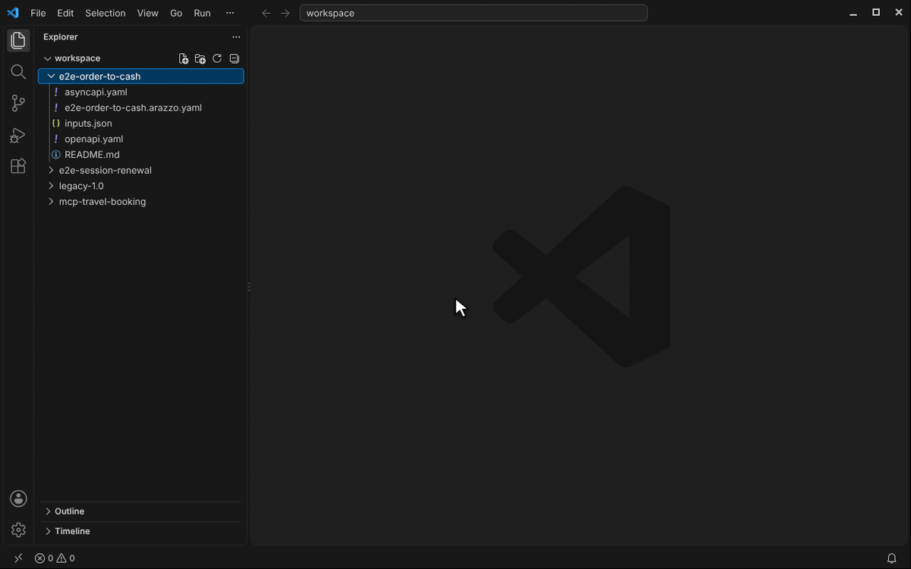
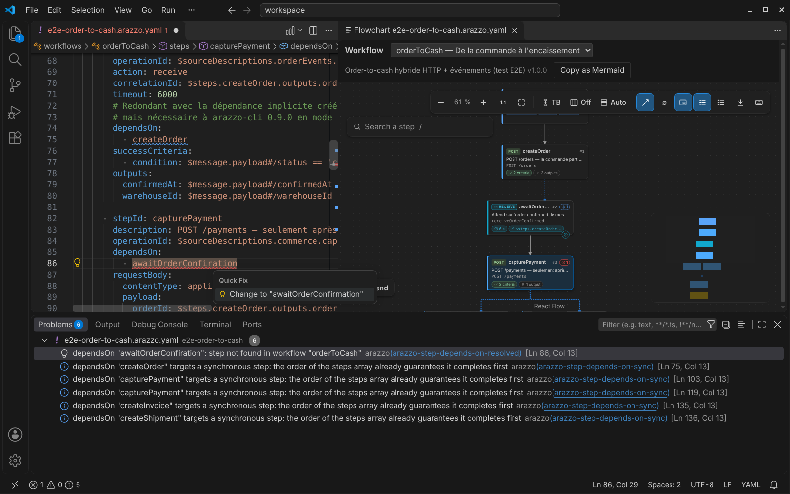
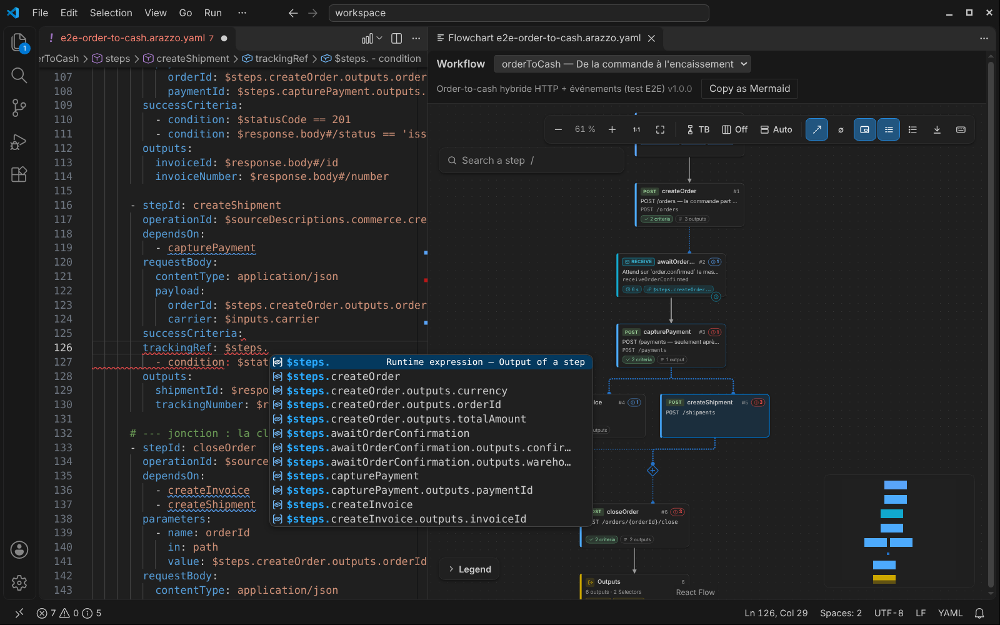
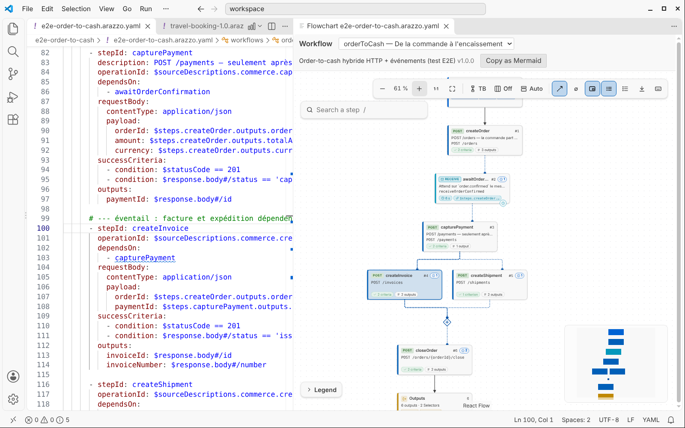
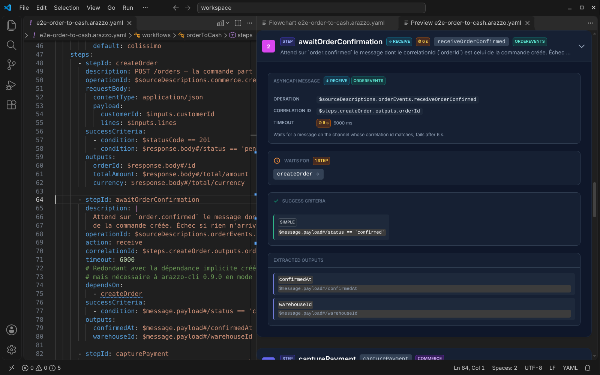

# Arazzo for VS Code — by ConnEthics

**Write [Arazzo](https://spec.openapis.org/arazzo/v1.1.0.html) workflows that humans can read and agents can run.** Arazzo 1.1 for OpenAPI and AsyncAPI in VS Code: validation against the official schema, completion, quick fixes, an interactive graph and live documentation, all in the editor.

## Why Arazzo?

An OpenAPI or AsyncAPI description lists endpoints and channels, but it doesn't say how to chain them to place an order, refund a customer or renew a session. That knowledge usually lives in wikis, Postman collections and test scripts. [Arazzo](https://spec.openapis.org/arazzo/v1.1.0.html), from the **OpenAPI Initiative**, describes these workflows in YAML: steps, data passed between steps, success criteria, branches, retries and failure handling. Code generators, E2E test runners and AI agents can then all execute the same workflow.

## Quick start

1. Install the extension from the [VS Code Marketplace](https://marketplace.visualstudio.com/items?itemName=connethics.arazzo-vscode).
2. Open a `.yaml` file that has a top-level `arazzo:` key, or create one: type `arazzo` in an empty YAML file and pick the **Arazzo 1.1 document** snippet.
3. Problems show up as you type. Press `Ctrl+.` / `Cmd+.` on a diagnostic for quick fixes.
4. Use the editor toolbar buttons or the Command Palette: **Open Arazzo Flowchart** for the graph, **Open Arazzo Preview** for the documentation.

## Features

### Validation for Arazzo 1.0 and 1.1

Validation runs as you type and has two layers. The first checks the document against the **official OpenAPI Initiative JSON Schema** of its version (Arazzo `1.0.x` or `1.1.x`). The second applies **more than 100 semantic rules** that a schema can't express:

- Step targets: exactly one of `operationId`, `operationPath`, `workflowId` or `channelPath`. `operationId`s are qualified when the document has several sources.
- AsyncAPI steps: `action: send|receive` is used only on AsyncAPI steps, `correlationId` only on `receive` steps, and `timeout` is positive.
- References resolve: `goto` targets (`stepId` / `workflowId`), step and workflow `dependsOn`, `$steps.…`, `$inputs.…`, `$components.…` and `$sourceDescriptions.…`. Dependency cycles are detected.
- Parameters: `in: querystring` is exclusive with `query`. Action `parameters` match the inputs of the target workflow.
- Criteria, Selectors and runtime expressions have valid syntax. `retryAfter` and `retryLimit` have valid values. IDs are unique and match the required pattern.
- Version consistency: a warning when a 1.1 feature appears in a `1.0.x` document, and a hint to add `$self` in 1.1.

Each diagnostic links to the matching section of the specification. Unused sources and components are faded.

### Completion and snippets

Completion is context-aware. It covers every 1.1 key, the enumerations (`asyncapi`, `send`/`receive`, `querystring`, `jsonpath`/`xpath`/`jsonpointer` and their versions) and runtime expressions such as `$message.payload`, `$self`, `$steps.<id>.outputs.<name>` and `$inputs.<name>`. It also proposes existing step and workflow IDs for `dependsOn` and `goto`. Inside a step, `$steps.` proposes only the steps it can reference: the earlier ones and those of its `dependsOn`.

The snippets cover the common structures:

| Prefix | Inserts |
|---|---|
| `arazzo` / `arazzo-doc` | A new Arazzo 1.1.0 document (`$self`, info, source, workflow) |
| `arazzo-workflow` | A workflow with inputs, one step and outputs |
| `arazzo-step-http` | An HTTP step calling an OpenAPI operation |
| `arazzo-step-send` / `arazzo-step-receive` | An AsyncAPI step: `send`, or `receive` with `correlationId` and `timeout` |
| `arazzo-depends-on` | A step-level `dependsOn` join |
| `arazzo-selector` | A Selector Object (JSONPath RFC 9535) |
| `arazzo-retry-workflow` | A failure action that runs a reusable workflow, then retries the step |
| `arazzo-mcp-tool` | A workflow shaped to be exposed as an MCP tool |

### Quick fixes

- **Migrate to Arazzo 1.1.0**: sets `arazzo: 1.1.0` and inserts a suggested `$self`. Available as a quick fix and as the command `Arazzo: Migrate to Arazzo 1.1.0`. A 1.0 document stays valid after migration.
- **Add `$self`** (the canonical URI of the document).
- **Did you mean…?** for an unknown `stepId` or `workflowId` in `goto` and `dependsOn`.
- **Use JSON Pointer** to rewrite a dotted expression such as `$response.body.id` into `$response.body#/id`.

### Interactive workflow graph

- **Follows your VS Code theme**, including high contrast. Node and edge colors come from the theme's own palette (`--vscode-charts-*`, `--vscode-testing-*`…).
- **Semantic edges**: sequence, success and failure `goto`, retry loops (`×N / Ns`), `end`, `dependsOn` joins and calls to other workflows. AsyncAPI steps show `send` / `receive`, `timeout` and `correlationId`.
- **Real HTTP methods**: badges are read from your local OpenAPI sources, not guessed from operation names.
- **Linked to the editor**: clicking a node moves the cursor to the step, double-click or `Enter` focuses the editor, and moving the cursor in the YAML selects the matching node. Validation problems appear as badges on the nodes.
- **Built to navigate**: zoom, fit, minimap, step search (`/`), full keyboard navigation, a synchronized list view, top-down or left-right layout and swimlanes per source. Large workflows stay smooth.
- **Export** to **SVG**, **PNG** or a **Mermaid** file, or copy the workflow as Mermaid to paste into Markdown.

The layout engine ([ELK](https://eclipse.dev/elk/)) runs in a Web Worker that complies with the webview Content Security Policy, so the editor never freezes.

### Arazzo 1.1 documentation view

The preview renders the whole specification as navigable documentation that updates as you type: sources (OpenAPI and AsyncAPI), workflows, steps, AsyncAPI messages (`send` / `receive`, `correlationId`, `timeout`), Selectors, step `dependsOn`, `$self`, parameters, criteria, actions and components. Clicking a node in the graph scrolls the documentation to that step.

### Outline

Workflows, steps, parameters and components appear in the **Outline** view and in **Go to Symbol** (`Ctrl+Shift+O` / `Cmd+Shift+O`).

## What's new in Arazzo 1.1

Arazzo 1.1.0 was published by the OpenAPI Initiative on 2026-05-17. Every `1.0.x` document remains valid.

| Feature | What it adds |
|---|---|
| **AsyncAPI sources** | `type: asyncapi` and `channelPath` steps, with `action: send` / `receive`, `correlationId` and `timeout` (ms) |
| **Step `dependsOn`** | A step waits for other steps: fan-out and join |
| **Workflow reuse from actions** | `onSuccess` / `onFailure` actions can call a workflow with `parameters`, for example renew a session and then retry |
| **Selector Object** | `context` + `selector` + `type` to extract values with JSONPath (RFC 9535), XPath or JSON Pointer |
| **Versioned expression types** | `jsonpath` `rfc9535`, `xpath` `xpath-31`, `jsonpointer` `rfc6901` |
| **`in: querystring`** | Pass the whole query string as a single value (aligned with OpenAPI 3.2) |
| **`$self`** | The canonical URI of the document, used to resolve relative references |

Your document is still 1.0? Run **Migrate to Arazzo 1.1.0** from the Command Palette.

## Use cases

### Give AI agents deterministic tools (MCP)

Expose **one Arazzo workflow as one MCP tool**. The `workflowId` becomes the tool name, `summary` and `description` become its description, `inputs` (JSON Schema) becomes its `inputSchema`, and `outputs` become its structured result. The MCP server runs the workflow, retries and failure handling included, so the agent no longer has to guess the call sequence. Start from the `arazzo-mcp-tool` snippet.

Open the examples in Arazzo Studio:
- [`mcp-travel-booking`](https://arazzo.connethics.com/builder?example=mcp-travel-booking): `quote_trip` (read-only), then `book_trip`, with compensation steps.
- [`mcp-support-refund`](https://arazzo.connethics.com/builder?example=mcp-support-refund): eligibility check, then refund, then a `refund.issued` event (AsyncAPI `send`).

### Executable end-to-end API tests

The same document runs as an E2E test in CI with existing runners (Redocly Respect, Specmatic, arazzo-cli) against mocks such as Prism or Microcks. Success criteria act as assertions, and `receive` steps wait for events.

- [`e2e-order-to-cash`](https://arazzo.connethics.com/builder?example=e2e-order-to-cash): HTTP order, then `receive` of `order.confirmed` with a 6 s timeout, then payment, then invoice and shipment joined with `dependsOn`.
- [`e2e-session-renewal`](https://arazzo.connethics.com/builder?example=e2e-session-renewal): a 401 triggers a failure action that runs `renewSession`, then the step is retried. Also covers `in: querystring`.
- [`e2e-onboarding-entreprise-fr`](https://arazzo.connethics.com/builder?example=e2e-onboarding-entreprise-fr): B2B onboarding with company lookup, KYC, account creation and a webhook.

Read the full story: [Arazzo 1.1 for MCP agents and E2E tests](https://www.connethics.com/insights/arazzo-1-1-mcp-e2e).

## The ConnEthics Arazzo toolkit

- **[Arazzo Studio](https://arazzo.connethics.com)**: build and visualize Arazzo workflows in the browser, with nothing to install. It uses the same validator and graph as this extension, plus an example gallery.
- **[Arazzo Skill file](https://arazzo.connethics.com/arazzo.skill.md)**: a Markdown guide that teaches AI coding assistants (Claude Code, Cursor, GitHub Copilot, Cline…) to write, review and fix Arazzo 1.1 documents, expose them as MCP tools and run them as E2E tests. Add it to your assistant's context or rules.
- **This extension**: authoring, validation and visualization in VS Code.

## Commands

| Command | Description |
|---|---|
| `Open Arazzo Preview` | Open the documentation view next to the editor |
| `Open Arazzo Flowchart` | Open the interactive workflow graph next to the editor |
| `Arazzo: Migrate to Arazzo 1.1.0` | Bump the document to `arazzo: 1.1.0` and add `$self` |

## Requirements

- VS Code 1.90 or newer.
- Arazzo documents are detected by their top-level `arazzo:` key in any `.yaml` / `.yml` file. Other YAML files are left alone.

## Privacy

The extension collects **no telemetry**. It reads only local files: your Arazzo document and, for HTTP method badges, the OpenAPI sources it references by relative or `file:` URL. Remote sources are never fetched.

## Support

- Questions, bugs and feature requests: [GitHub Issues](https://github.com/connEthics/arazzo-vscode/issues). See [SUPPORT.md](SUPPORT.md).
- Contributions are welcome: see [CONTRIBUTING.md](CONTRIBUTING.md).
- Help designing API workflows, MCP tools or E2E test strategies: [ConnEthics](https://www.connethics.com/arazzo).

## License

The extension is released under the [MIT License](LICENSE) © ConnEthics. It bundles:

- `@connethics/arazzo-core` and `@connethics/arazzo-flow` (MIT, ConnEthics), with the official Arazzo JSON Schemas of the OpenAPI Initiative (Apache-2.0);
- the [Eclipse Layout Kernel](https://eclipse.dev/elk/) (`elkjs`) under the **Eclipse Public License 2.0**, shipped unmodified as a separate worker script;
- React, React Flow and other open-source libraries under their own licenses.

The full list is in [THIRD-PARTY-NOTICES.md](THIRD-PARTY-NOTICES.md).

*Postcardware*: if this extension helps you, send a virtual postcard to **hello@connethics.com** and tell us who you are and how you use Arazzo.

---

**Arazzo for VS Code** is built by **[ConnEthics](https://www.connethics.com)**. It is not an official OpenAPI Initiative product. Arazzo is a specification of the OpenAPI Initiative, a Linux Foundation project.
